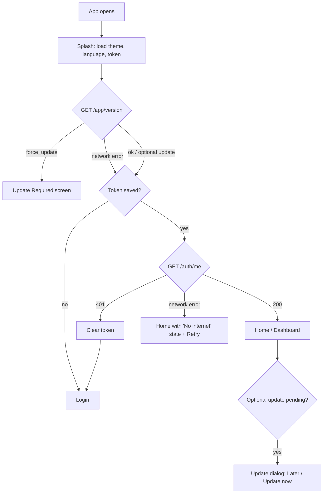
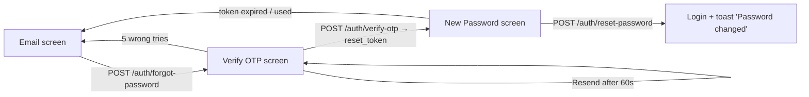
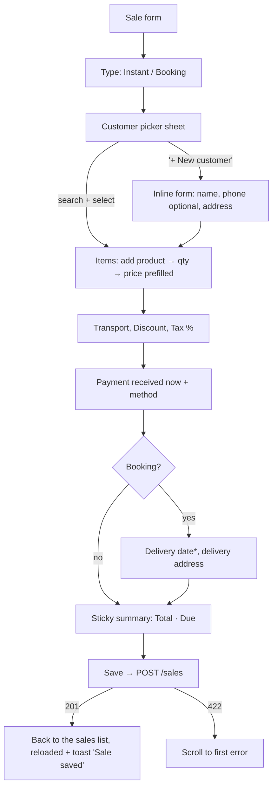
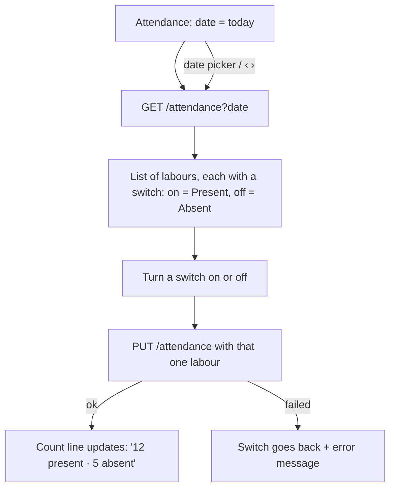
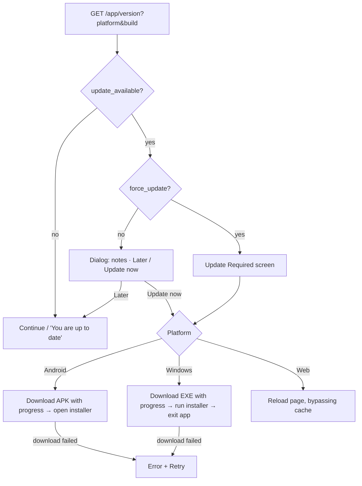

# 03 · App Flow: FlyAsh

| | |
|---|---|
| **Document** | App flow, navigation and screen-by-screen behaviour |
| **Version** | 1.0 |
| **Date** | 2026-11-08 |
| **Related docs** | 01-PRD (features) · 02-TRD (API) · 04-UI-UX (visuals) · 05-Backend-Schema (data) |

---

## 1. App Launch



- Theme and language load **before** the first frame (no flash).
- After login (and on `/auth/me`), the app applies the user's saved `locale`, `theme_mode` and `accent_color` if they differ from the cached values, so language and theme follow the user to every device.
- The version check never blocks launch for more than 3 s. If it times out, the app continues.
- "Later" on an optional update hides the dialog until the next launch.

## 2. Authentication Flows

### 2.1 Login

```
Login
 ├─ Enter phone/email + password → "Sign in"
 │    (phone with or without +91 / 91: 9876543210, +91 98765-43210 …)
 │    ├─ 200 → save token → Home
 │    ├─ 422 → field errors under inputs
 │    ├─ 400 "Invalid credentials" → error text above the button
 │    └─ 429 → "Too many attempts. Try again in 15 minutes"
 ├─ "Forgot password?" → Forgot Password (2.2)
 └─ Language switch (EN / বাংলা)
```

### 2.2 Forgot password (3 screens)



| Screen | Behaviour |
|---|---|
| ① Email | Validate the email format → send → always show "If this email is registered, an OTP has been sent" → go to ② (the email is passed along) |
| ② Verify OTP | Shows the **full email in its own card with a "Change" button** next to it → back to ① with the email filled in, so a typo is easy to spot and fix. 6 boxes, auto-submit on the 6th digit. Wrong → "Wrong OTP · N tries left". 60 s resend countdown |
| ③ New Password | The `reset_token` is held in memory only (route argument). New + confirm. Back → confirm "Cancel password reset?" → Login |

### 2.3 Logout

Drawer or Settings → "Log out" → confirm dialog → `POST /auth/logout` → clear the token and in-memory state → Login. The token is cleared locally even if the request fails.

### 2.4 Session expiry (global)

Any API call returning **401** → clear the token → Login with the toast "Session ended, please log in again". This happens when the user was deactivated, their password was reset by someone else, or they logged out on this device elsewhere.

## 3. Navigation Structure

### 3.1 Shell

```
┌──────────────────────────────────────────┐
│ ☰  Section title                         │   ← app bar: ☰ opens the drawer
├──────────────────────────────────────────┤
│  (screen content)                        │
├──────────────────────────────────────────┤
│   Home │ Sales │ Attendance │ Expenses    │   ← phone: bottom nav (4 items)
└──────────────────────────────────────────┘
☰ (app bar, left) → opens the side drawer:
  Dashboard · Sales · Upcoming Deliveries · Customers · Products
  Labours (tabs: Labours · Wages) · Attendance · Expenses · Reports · Users · Settings
  [Need help?]  ·  Log out
```

- **Tablet (≥ 600 dp):** navigation rail with the same 4 items; ☰ in the app bar opens the drawer. **Desktop/Web (≥ 1024 dp):** a persistent, collapsible sidebar with every section (no ☰).
- When a drawer section (Customers, Reports …) is open, no bottom/rail item is highlighted.
- Web URLs have no `#`: `/expenses`, `/sales/<uuid>` (path URL strategy; Nginx serves `index.html` for unknown paths).
- **Every screen has its own URL**, also screens opened with `push()` (forgot password, OTP, new password, galleries) — `GoRouter.optionURLReflectsImperativeAPIs = true`. Private values (email, reset token) travel in `extra`, never in the URL; refreshing `/forgot-password/verify` or `/reset` returns to `/forgot-password`.
- Each bottom tab keeps its own navigation stack (go_router `StatefulShellRoute`). Opening a section from the bottom nav, rail or drawer **always shows its list** (`goBranch(index, initialLocation: true)`), even if a detail page was left open there before.
- **The app bar stays still while swiping:** the pager draws one fixed bar (with a shadow); only the title and buttons cross-fade. The bottom bar has a shadow too.
- **A section left on an inner page** (Upcoming deliveries, a form …) through the bottom bar or drawer is put back on its list, so a later swipe to it shows the list and swiping keeps working.
- **Swipe between tabs (phone and tablet), like WhatsApp:** on the first screen of Home, Sales, Attendance or Expenses, swipe left / right to go to the next / previous bottom-bar section; the page follows the finger and a short drag springs back. A bottom-bar tap slides there too. Swiping does not work on detail pages and forms (their own horizontal gestures stay theirs), in drawer sections, or on desktop. Each section keeps its own state and scroll position while you swipe.
- The system status bar (clock, battery) is black on every screen.
- **Back button — what is open on top closes first:** the drawer, a dialog, a bottom sheet or a ⋮ / long-press menu. Only when nothing is open does back change the page.
  - Android: back pops the section's stack; on a section's first screen it goes to Home; on Home it leaves the app (there is no "press back again" prompt).
  - Web, after the app closes a page itself (Save on a form, the ← arrow): the browser history steps back too, so the closed page is not "behind" you. Example: list → edit → Save → list; browser back now goes to the page before the list, not to the edit form again. (Browser **forward** can still reopen the closed page.)
  - Web: the browser's back button follows the same rule. With the drawer, a dialog, a sheet or a menu open it closes it, keeps the page and puts the current URL back in the address bar; with nothing open it goes to the previous page.

### 3.2 Route table (go_router)

| Route | Screen | Notes |
|---|---|---|
| `/splash` | Splash | Initial route |
| `/update-required` | Forced update | No way out except Update |
| `/login` | Login | Public |
| `/forgot-password` | ① Email | Public |
| `/forgot-password/verify` | ② Verify OTP | `extra: email` |
| `/forgot-password/reset` | ③ New password | `extra: reset_token` |
| `/home` | Dashboard | Tab 1 |
| `/sales` | Sales list | Tab 2 |
| `/sales/new?type=instant\|booking` | Sale form | |
| `/sales/:id` | Sale detail | |
| `/sales/:id/edit` | Sale form (edit) | |
| `/sales/upcoming` | Upcoming deliveries | |
| `/attendance?date=` | Attendance | Tab 3 |
| `/expenses` | Expense list | Tab 4 |
| `/expenses/new` · `/expenses/:id/edit` | Expense form | `/expenses/:id` redirects to the edit form (no detail page) |
| `/customers` · `/customers/new` · `/customers/:id` · `/customers/:id/edit` | Customers | |
| `/products` · `/products/new` · `/products/:id` · `/products/:id/edit` | Products | `:id` is a read-only detail page |
| `/labours` · `/labours/new` · `/labours/:id` · `/labours/:id/edit` | Labours (tab 1) | |
| `/labours/wages?month=` · `/labours/wages/:labourId?month=` | Wage sheet (tab 2) / labour wage detail | Wages is a tab inside Labours, not a separate section |
| `/reports` · `/reports/:type` | Reports | `type` = sales, dues, expenses, wages, net-profit, collections |
| `:id` in every route | | A UUID (v7), not a number |
| `/users` · `/users/new` · `/users/:id` · `/users/:id/edit` | Users | |
| `/profile` · `/profile/edit` · `/profile/password` | My profile | |
| `/settings` · `/settings/factory` · `/settings/appearance` · `/settings/language` · `/settings/about` | Settings | |

**Redirect rule:** while the session is checked → `/splash`. Signed out → any private route redirects to `/login?from=<page>` (Home is never kept, it is the default). Signed in → `/splash`, `/login` and `/forgot-password*` redirect to the `from` page (only internal, private pages) or `/home`. So a deep link such as `/sales/<uuid>` opens after login. `from` is **base64url** (`/login?from=L3NhbGVz` = `/sales`), because Flutter web shows percent-encoded values decoded in the address bar.

## 4. Dashboard (Home)

```
Home (no greeting, name, factory or date line; the page starts with the hero card)
 ├─ Pull to refresh → GET /dashboard
 ├─ Hero "Today's Sales" (light card; tap) → /sales?period=today
 ├─ KPI "Total due" → /reports/dues (dues report)
 ├─ KPI "Deliveries today" → /sales/upcoming
 ├─ KPI "Present today" → /attendance (today)
 ├─ KPI "Month expenses" → /expenses
 ├─ Quick: New Sale → /sales/new?type=instant
 ├─ Quick: New Booking → /sales/new?type=booking
 ├─ Quick: Attendance → /attendance
 ├─ Quick: Add Expense → /expenses/new
 ├─ Recent sales row → /sales/:id
 └─ App bar: language (popover: English / বাংলা) · appearance (popover) · bell
```

KPI cards show the label and value on the left and the icon on the right. While loading, the hero card and the KPI cards show skeletons.

## 5. Sales Flows

### 5.1 New sale (instant or booking)



**Form behaviour**
- The summary bar updates live on every change (a local preview). The server's numbers are final after save.
- New customer inline: the phone is optional. A duplicate phone (422 with `existing_customer_id`) shows "This phone belongs to Rahim Traders · Use this customer".
- Products: only active ones are shown. Selecting one fills `unit_price` from the product's price, and it stays editable. There is no cost and no unit.
- Tax: a percentage (0–100) on `subtotal + transport − discount`. Total = that amount + tax.
- Each item card has a remove (✕) button, and at least 1 item is required.
- Payment amount above the total → inline error "Cannot be more than total ₹33,500".
- Leaving with unsaved changes → "Discard this sale?" dialog.
- The form state survives a network error (Retry keeps all the input).
- After save: a new sale returns to the list. An edit opened from the list returns to the list; an edit opened from the detail page returns to the detail page. The form is popped, never stacked.

### 5.2 Sale detail actions

The app bar has ✏ **Edit** and a **⋮** menu. There are no action buttons in the page body.

| Action | Where / shown when | Flow |
|---|---|---|
| **Edit** | ✏, not cancelled | `/sales/:id/edit`. If the new total < paid → server 400 shown as a message |
| **Add payment** | ⋮, due > 0 and not cancelled | Bottom sheet: amount (prefilled with the due), date (today), method, note → `POST /sales/:id/payments` → refresh |
| **Mark delivered** | ⋮, booking + `booked` | Sheet: delivered date (today) → `POST /sales/:id/deliver` |
| **Cancel booking** | ⋮, booking + `booked` | If it has payments → dialog "Remove payments first (refund)". Else confirm → `POST /sales/:id/cancel` |
| **Delete sale** | ⋮ | Confirm "Delete INV-000101? It will be removed from all reports" → `DELETE /sales/:id` → back to the list |
| **Delete payment** | long press a payment row | Confirm → `DELETE …/payments/:id` |
| **Call / WhatsApp** | customer card, only if the customer has a phone | `url_launcher` (`tel:` / `https://wa.me/91…`) |
| **Share receipt** | ⋮ | Build the PDF on the device (factory profile from `GET /settings/factory`) → share sheet (WhatsApp, mail, Files …; on the web it downloads, on Windows a save dialog). Failure → "Could not make the receipt" |
| **Print receipt** | ⋮ | Same PDF → system print dialog (also offers "Save as PDF") |

The page shows the totals including the tax line, and has pull to refresh.

### 5.3 Sales list

- Tabs: All / Instant / Booking. Filter sheet: date range presets + status chips. Search by customer, phone or invoice no. (debounced 400 ms).
- Flat rows (no card border or background). Tap → detail. **Long press → action menu** next to the row.
- Endless scroll (`page`, `limit=20`) with no "Showing x of y" line, pull to refresh, a skeleton shaped like the list while loading, and an empty state with a "New sale" button.

### 5.4 Upcoming deliveries

A list of `booked` sales sorted by `delivery_date`. Overdue rows are on top with an "Overdue" pill. Each row has a "Mark delivered" button → the same sheet as 5.2.

## 6. Customers & Products

```
Customers list ─ search / "Has due" chip ─ FAB → Customer form (name, phone optional, address) → Save → back to the list
Customer row   ─ name · phone ("-" when none) · due; no address
               ─ tap → detail · long press → View · Edit | Call · WhatsApp (if phone) | Deactivate/Activate | Delete
Customer detail ─ ✏ Edit · ⋮ (same actions)
                └─ Stat cards 2 × 2 (Purchases · Paid · Due · Sales; open bookings count) → "Sales" + a line → Sales list (paginated) → Sale detail

Products list ─ search / Active-Inactive toggle ─ FAB → Product form (name, price, notes) → Save → back to the list
Product row   ─ tap → Product detail · long press → View · Edit | Deactivate/Activate | Delete
Product detail (read only: name, price, status, notes) ─ ✏ Edit · ⋮ → Deactivate/Activate | Delete
                 (409 on delete → "Product is used in sales. Deactivate instead?")
Product form  ─ only the fields and Save (no Deactivate / Delete here)
```

A product has a **price only**: no unit and no cost.

## 7. Labours, Attendance & Wages

### 7.1 Labours

```
Labours section = 2 tabs: Labours (/labours) · Wages (/labours/wages)
  (sliding pill tabs like Sales; each tab has its own URL, and switching slides the pill)

Labours list ─ search ─ FAB → Labour form: name, phone, address,
                               wage type Daily/Monthly + wage amount (both required), joining date
Labour row   ─ name · wage | all-time earned · "Paid ₹…" · "Bal ₹…" (no present / absent)
             ─ tap → detail · long press → View · Edit | Call | Deactivate/Activate
Labour detail ─ Info · Stat cards 2 × 2 for this month (Earned · Paid · Balance · Days present)
             · Total wage (all time): earned · paid · balance · attendance (mini calendar)
             ─ ✏ Edit · ⋮ → Pay wage · Wage details · Deactivate (asks for the leaving date)
```

### 7.2 Attendance



- There is **no half day**, no "Mark all present" and **no Save button**: each switch saves at once.
- Present stores a row in `attendances`; absent removes the row (no row = absent).
- Future dates are disabled in the picker and on the › arrow.
- The list has a search box.
- Each row shows the **day wage** (`₹450 / day`): the saved wage when present, the usual wage for one day when absent (monthly ÷ days in the month).
- ✏ sits right next to the wage (not next to the switch) and works only while the labour is **absent**: it opens "Day wage for <name>" (compact dialog) → Save. The row shows the new wage like any wage (no "edited" label) and ↺ appears next to ✏; ↺ goes back to the usual wage (shown only when the wage is not the usual one; off while present, like ✏). The wage is sent with the next switch-on and **kept while the list is open**, also after switching back to absent (a 300 stays 300). Changing the date clears it.
- Only the switch marks attendance; tapping the row does nothing.

### 7.3 Wages (tab inside Labours)

```
Labours → Wages tab (/labours/wages, month selector) → GET /wages?month
 ├─ Hero: total earned · strip: Paid · Balance
 └─ Row per labour → Labour wage detail (/labours/wages/:labourId?month)
        ├─ Breakdown: present days × rate − paid = balance
        ├─ Day-by-day attendance list
        ├─ ⋮ → "Pay wage" → sheet (amount prefilled with the balance, date, method, note) → POST /labours/:id/wage-payments
        └─ Payment row: long press → Delete (confirm)
```

There are **no advances**. Money given early is recorded as a wage payment.

## 8. Expenses

```
Expenses list → GET /expenses
 ├─ "Spent" card: the total for the current filter (light card, like Home's hero)
 ├─ Search box + filter button (right of the search box)
 │     └─ Filter sheet: period (Today · This week · This month · All …) and category
 ├─ FAB → Expense form: date, category (any text; one row of small chips, scrolled sideways, suggests used + default names), amount, note
 │        → Save → POST /expenses → back to the list
 └─ Row: tap → Expense form (edit) · long press → Edit | Delete
```

A category is **free text** saved on the expense. There is no category list to manage.

## 9. Reports

```
Reports grid (6 tiles; 2 columns on phone, 3 on wider screens) → tap → /reports/:type
 ├─ Period: chips Today · This week · This month (default) · Last month · This year · Custom (date range picker)
 │    Wages: month selector ‹ Nov 2026 › (no future months) · Dues: no period (all open dues now)
 ├─ Summary cards → Chart (tap a bar for its value) → Table(s)
 ├─ Pull to refresh; any data change (sale, payment, expense, wage …) reloads the open report
 └─ ⋮ → Export PDF / Export Excel → made on the device from what is shown → share / print / save
       (on the web the file is downloaded); failure → "Could not export the report"
Dues report rows → Customer detail
Unknown /reports/<x> → back to the grid

Report contents
 Sales        Sales amount, number of sales · bars by day · tables by product (qty, amount), by day
 Dues         Total due, customers · table customer + phone, oldest due, total due (largest first)
 Expenses     Total, top category · horizontal bars by category · table category, share %, amount
 Wages        Earned, paid, balance · horizontal bars of earned per labour · table days, earned, paid, balance
 Net profit   Sales (without tax), expenses, wages, net profit · monthly net-profit bars (losses red, below a zero line) · monthly table
 Collections  Received · bars by day · tables by method (Cash, UPI …), by day
```

## 10. Users & Profile

```
Users list (current user hidden) ─ search ─ FAB → Add user form (name, phone, email, password)
User row ─ like a customer row: name · phone ("-" when none) · "Inactive" when deactivated; no last login
User detail ─ ✏ Edit · ⋮ → Reset password (dialog: new + confirm) · Deactivate / Activate (confirm)
Empty list → "Only you so far · Add user"

Desktop: the list is a table (name, phone, email, last login, status); phone/tablet: cards.
Last login is shown in the device's local time.

My Profile (Settings or drawer header tap; the drawer also has a sun/moon Light ↔ Dark toggle)
 ├─ Edit profile (name, phone, email) → PUT /auth/me
 └─ Change password (current, new, confirm) → PUT /auth/password → toast "Password changed. Other devices were logged out"
```

## 11. Settings

```
Settings
 ├─ My profile → §10
 ├─ Factory profile → name, owner name, phone, email, address, invoice prefix → PUT /settings/factory
 ├─ Appearance → mode, accent (applied instantly, saved locally and to the account with PUT /auth/preferences), font size (saved locally)
 ├─ Language → English / বাংলা (applied instantly, saved locally and to the account with PUT /auth/preferences)
 ├─ About & Updates → app version + build → "Check for updates" → §12
 └─ Log out → §2.3
```

## 12. App Update Flow



- Android: the first time, the system asks to allow "Install unknown apps" for FlyAsh. The app shows a short explanation before opening that settings page.
- A download in progress can be cancelled from an optional update, but not from a forced one.

## 13. Common Behaviour (all screens)

| Situation | Behaviour |
|---|---|
| First load | Skeleton placeholders shaped like the screen: list (with the search box), detail and form pages each have their own. No plain spinner |
| Refresh | Pull to refresh on every list, every detail page and the dashboard; it always asks the server (skips the cache) |
| Cache | A screen opened again within 60 s (tab switch, back, same filter) shows at once from the in-memory cache |
| After a change | Only the screens showing the changed data reload, **in the background** (rows stay, no skeleton). E.g. a new sale reloads Sales, Customers and Home, not Products (02-TRD §7.5) |
| Optimistic updates | Deactivate / activate, delete (rows and payments) and attendance switches change the screen at once; if the server refuses, the change is undone and its message is shown |
| Pagination | Endless scroll: load the next page at 80% scroll, with a footer spinner. No "Showing x of y" line anywhere (lists and picker sheets) |
| Search | Every search box has an ✕ to clear it. Leaving a section clears its search, so a section opened again shows everything |
| Deletes | "Keep this" / "Yes, delete". The dialog waits for the server (buttons off, spinner next to "Yes, delete"); deleted → it closes and the row goes; refused → the message shows in the dialog and as a toast, the dialog stays open until the user closes it. Rows are never removed before the server confirms |
| Dialogs | Compact on phones: 15 px title, 40 px buttons |
| Money | `₹450` for whole amounts, `₹0.11` / `₹800.50` when there are paise (everywhere: lists, details, forms) |
| Skeletons | Shaped like each screen's own rows; fixed texts (titles, labels such as "present · absent", quick actions) show as text, only values are placeholders |
| Numbers | Home and stat-card numbers count up when they appear |
| List rows | Flat (no border, no own background). Tap opens the item; **long press opens its action menu** (a popup next to the row) |
| After save | Create → back to the list. Edit → back to where it was opened from (list or detail). Forms are popped, so no extra screens stay in the stack |
| Detail actions | ✏ Edit in the app bar; other actions in the ⋮ menu |
| List → detail | Products, customers, labours, users: the detail page opens at once with the row's data (no skeleton) and the avatar flies from the row to the header; the latest data then loads in the background. From a link or after a refresh it loads with a skeleton |
| Motion | Rows fade in one after another on first load; tappable cards squash a little while pressed; dialogs sit slightly above the middle. All of it is off with "Reduce motion" |
| Phone input | Typing or pasting `+91 98765-43210` or `098765 43210` gives `9876543210` |
| Haptics | A light tick with the attendance switch; a strong buzz when a delete is refused and the row comes back |
| Empty | Illustration + hint + primary action |
| No internet | Inline "No internet connection" + Retry. Forms keep the typed data |
| Server error (500) | "Something went wrong. Please try again" + Retry |
| Validation (422) | Error text under each field, scroll to the first error |
| Business rule (400 / 409) | Show the server `message` in a dialog or snackbar |
| Success | Snackbar 3 s (with Undo for deletes where possible) |
| Destructive actions | Always a confirm dialog with a red action button |
| Double submit | The Save button shows a spinner and is disabled until the response arrives |
| Money input | Numeric keyboard, ₹ prefix, Indian grouping while typing |
| Dates | Default = the factory's today from the `X-Business-Date` header (not the device clock). Future dates are blocked where the PRD says so. Timestamps (`created_at` …) are shown in the device timezone; business dates (`sale_date` …) are shown as is |
