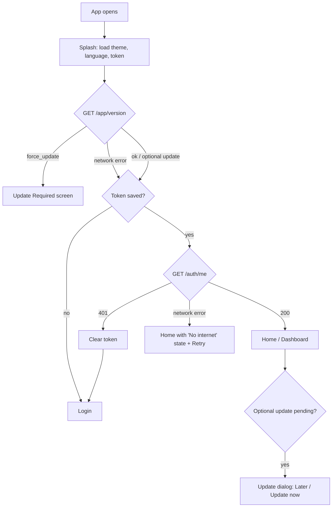
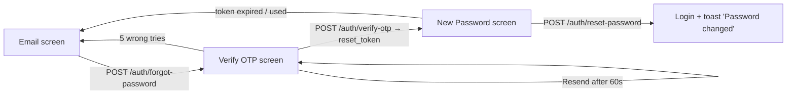
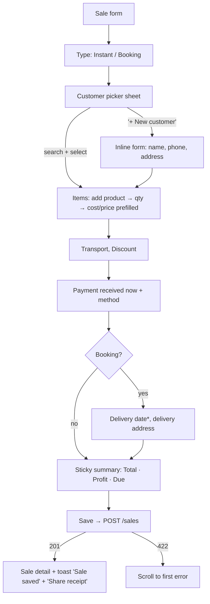
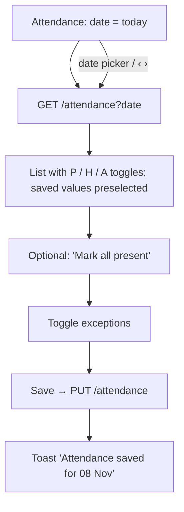
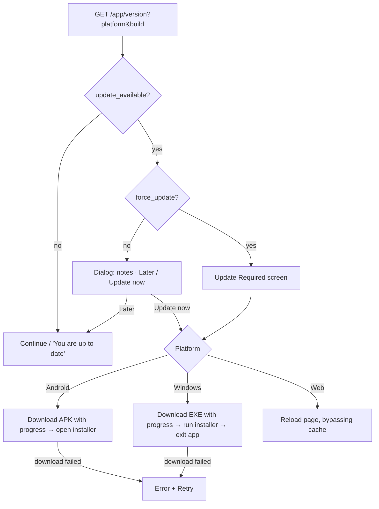

# 03 · App Flow: FlyAsh

| | |
|---|---|
| **Document** | App flow, navigation and screen-by-screen behaviour |
| **Version** | 1.0 |
| **Date** | 2026-11-08 |
| **Related docs** | 01-PRD (features) · 02-TRD (API) · 04-UI-UX (visuals) · 05-Backend-Schema (data) |

---

## 1. App Launch



- Theme and language load **before** the first frame (no flash).
- After login (and on `/auth/me`), the app applies the user's saved `locale`, `theme_mode` and `accent_color` if they differ from the cached values, so language and theme follow the user to every device.
- The version check never blocks launch for more than 3 s. If it times out, the app continues.
- "Later" on an optional update hides the dialog until the next launch.

## 2. Authentication Flows

### 2.1 Login

```
Login
 ├─ Enter phone/email + password → "Sign in"
 │    ├─ 200 → save token → Home
 │    ├─ 422 → field errors under inputs
 │    ├─ 400 "Invalid credentials" → error text above the button
 │    └─ 429 → "Too many attempts. Try again in 15 minutes"
 ├─ "Forgot password?" → Forgot Password (2.2)
 └─ Language switch (EN / বাংলা)
```

### 2.2 Forgot password (3 screens)



| Screen | Behaviour |
|---|---|
| ① Email | Validate the email format → send → always show "If this email is registered, an OTP has been sent" → go to ② (the email is passed along) |
| ② Verify OTP | 6 boxes, auto-submit on the 6th digit. Wrong → "Wrong OTP · N tries left". 60 s resend countdown. Back → ① |
| ③ New Password | The `reset_token` is held in memory only (route argument). New + confirm. Back → confirm "Cancel password reset?" → Login |

### 2.3 Logout

Drawer or Settings → "Log out" → confirm dialog → `POST /auth/logout` → clear the token and in-memory state → Login. The token is cleared locally even if the request fails.

### 2.4 Session expiry (global)

Any API call returning **401** → clear the token → Login with the toast "Session ended, please log in again". This happens when the user was deactivated, their password was reset by someone else, or they logged out on this device elsewhere.

## 3. Navigation Structure

### 3.1 Shell

```
┌──────────────────────────────────────────┐
│  (screen content)                        │
├──────────────────────────────────────────┤
│  Home │ Sales │ Attendance │ Expenses │ More │   ← phone: bottom nav
└──────────────────────────────────────────┘
More → opens the side drawer:
  Dashboard · Sales · Upcoming Deliveries · Customers · Products
  Labours · Attendance · Wages · Expenses · Reports · Users · Settings
  [Need help?]  ·  Log out
```

- **Tablet (≥ 600 dp):** navigation rail with the same 5 items. **Desktop/Web (≥ 1024 dp):** a persistent sidebar with the full drawer list.
- Each bottom tab keeps its own navigation stack (go_router `StatefulShellRoute`).
- Android back button: pops the stack. On the root of a tab it goes to Home, and on Home it asks "Press back again to exit".

### 3.2 Route table (go_router)

| Route | Screen | Notes |
|---|---|---|
| `/splash` | Splash | Initial route |
| `/update-required` | Forced update | No way out except Update |
| `/login` | Login | Public |
| `/forgot-password` | ① Email | Public |
| `/forgot-password/verify` | ② Verify OTP | `extra: email` |
| `/forgot-password/reset` | ③ New password | `extra: reset_token` |
| `/home` | Dashboard | Tab 1 |
| `/sales` | Sales list | Tab 2 |
| `/sales/new?type=instant\|booking` | Sale form | |
| `/sales/:id` | Sale detail | |
| `/sales/:id/edit` | Sale form (edit) | |
| `/sales/upcoming` | Upcoming deliveries | |
| `/attendance?date=` | Attendance | Tab 3 |
| `/expenses` | Expense list | Tab 4 |
| `/expenses/new` · `/expenses/:id/edit` | Expense form | |
| `/customers` · `/customers/new` · `/customers/:id` · `/customers/:id/edit` | Customers | |
| `/products` · `/products/new` · `/products/:id/edit` | Products | |
| `/labours` · `/labours/new` · `/labours/:id` · `/labours/:id/edit` | Labours | |
| `/wages?month=` · `/wages/:labourId?month=` | Wage sheet / labour wage detail | |
| `/reports` · `/reports/:type` | Reports | `type` = sales, dues, expenses, wages, net-profit, collections |
| `/users` · `/users/new` · `/users/:id` · `/users/:id/edit` | Users | |
| `/profile` · `/profile/edit` · `/profile/password` | My profile | |
| `/settings` · `/settings/factory` · `/settings/appearance` · `/settings/language` · `/settings/about` | Settings | |

**Redirect rule:** no token → any private route redirects to `/login`. A token present → `/login` and `/forgot-password*` redirect to `/home`.

## 4. Dashboard (Home)

```
Home
 ├─ Pull to refresh → GET /dashboard
 ├─ Hero "Today's Sales" (tap) → /sales?from=today&to=today
 ├─ KPI "Total due" → /reports/dues
 ├─ KPI "Deliveries today" → /sales/upcoming
 ├─ KPI "Present today" → /attendance (today)
 ├─ KPI "Month expenses" → /expenses?from=month_start
 ├─ Quick: New Sale → /sales/new?type=instant
 ├─ Quick: New Booking → /sales/new?type=booking
 ├─ Quick: Attendance → /attendance
 ├─ Quick: Add Expense → /expenses/new
 ├─ Recent sales row → /sales/:id
 └─ Bell → (v1: upcoming deliveries + overdue list)
```

## 5. Sales Flows

### 5.1 New sale (instant or booking)



**Form behaviour**
- The summary bar updates live on every change (a local preview). The server's numbers are final after save.
- New customer inline: the phone is checked on save. A duplicate phone (422 with `existing_customer_id`) shows "This phone belongs to Rahim Traders · Use this customer".
- Products: only active ones are shown. Selecting one fills `unit_cost` and `unit_price` from the defaults, and both stay editable.
- Each item card has a remove (✕) button, and at least 1 item is required.
- Payment amount above the total → inline error "Cannot be more than total ₹33,500".
- Leaving with unsaved changes → "Discard this sale?" dialog.
- The form state survives a network error (Retry keeps all the input).

### 5.2 Sale detail actions

| Action | Shown when | Flow |
|---|---|---|
| **Add payment** | due > 0 and not cancelled | Bottom sheet: amount (prefilled with the due), date (today), method, note → `POST /sales/:id/payments` → refresh |
| **Delete payment** | per payment row (⋮) | Confirm → `DELETE …/payments/:id` |
| **Mark delivered** | booking + `booked` | Sheet: delivered date (today) → `POST /sales/:id/deliver` |
| **Cancel booking** | booking + `booked` | If it has payments → dialog "Remove payments first (refund)". Else confirm → `POST /sales/:id/cancel` |
| **Edit** | not cancelled | `/sales/:id/edit`. If the new total < paid → server 400 shown as a message |
| **Share receipt** | always | Build the PDF on the device → share sheet (WhatsApp, etc.) / Print / Save |
| **Call / WhatsApp** | customer card | `url_launcher` (`tel:` / `https://wa.me/91…`) |
| **Delete sale** | ⋮ menu | Confirm "Delete INV-000101? It will be removed from all reports" → `DELETE /sales/:id` → back to the list |

### 5.3 Sales list

- Tabs: All / Instant / Booking. Filter sheet: date range presets + status chips. Search by customer, phone or invoice no. (debounced 400 ms).
- Infinite scroll (`page`, `limit=20`), pull to refresh, skeleton while loading, and an empty state with a "New sale" button.

### 5.4 Upcoming deliveries

A list of `booked` sales sorted by `delivery_date`. Overdue rows are on top with an "Overdue" pill. Row swipe or button "Delivered" → the same sheet as 5.2.

## 6. Customers & Products

```
Customers list ─ search / "Has due" chip ─ FAB → Customer form → Save → Customer detail
Customer detail ─ Call · WhatsApp · Edit · ⋮ (Delete if no sales / Deactivate)
                └─ Summary strip (Purchases · Paid · Due) → Sales list (paginated) → Sale detail

Products list ─ search / Active-Inactive toggle ─ FAB → Product form → Save → back to list
Product row ⋮ ─ Edit · Deactivate/Activate · Delete (409 → "Product is used in sales. Deactivate instead?")
```

## 7. Labours, Attendance & Wages

### 7.1 Labours

```
Labours list ─ search ─ FAB → Labour form (wage type toggle Daily/Monthly, amount, joining date)
Labour detail ─ Info · This month's attendance (mini calendar) · Wage summary card
             ─ Actions: Edit · Give advance · Pay wage · Deactivate (asks for the leaving date)
```

### 7.2 Attendance



- Future dates are disabled in the picker and on the › arrow.
- Unsaved changes + date change or back → "Save changes for 08 Nov?" (Save / Discard).
- Unmarked labours show an empty toggle and count in "Not marked". Save sends only the marked ones.

### 7.3 Wages

```
Wages (month selector) → GET /wages?month
 ├─ Hero: total earned · strip: Advances · Paid · Balance
 └─ Row per labour → Labour wage detail (/wages/:labourId?month)
        ├─ Breakdown: worked days × rate − advances − paid = balance
        ├─ Day-by-day attendance list
        ├─ "Give advance" → sheet (amount, date, note) → POST /labours/:id/advances
        ├─ "Pay wage" → sheet (amount prefilled with the balance, date, method, note) → POST /labours/:id/wage-payments
        └─ Advance / payment rows ⋮ → Delete (confirm)
```

## 8. Expenses

```
Expenses list (period selector + category chips) → GET /expenses
 ├─ Header: period total
 ├─ FAB → Expense form: date, category (sheet with "+ New category"), amount, note → Save → POST /expenses
 └─ Row → Expense form (edit) · ⋮ Delete
Categories: from the category sheet → "Manage categories" → rename / deactivate / add
```

## 9. Reports

```
Reports grid → choose report → Report screen
 ├─ Period presets (Today, This week, This month, Last month, This year, Custom)
 ├─ Summary cards → Chart → Table
 └─ Export (⋮) → PDF / Excel → generated on the device → share / save
Dues report rows → Customer detail
```

## 10. Users & Profile

```
Users list (current user hidden) ─ search ─ FAB → Add user form (name, phone, email, password)
User detail ─ Edit · Reset password (sheet: new + confirm) · Deactivate / Activate (confirm)
Empty list → "Only you so far · Add user"

My Profile (Settings or drawer header tap)
 ├─ Edit profile (name, phone, email) → PUT /auth/me
 └─ Change password (current, new, confirm) → PUT /auth/password → toast "Password changed. Other devices were logged out"
```

## 11. Settings

```
Settings
 ├─ My profile → §10
 ├─ Factory profile → name, owner name, phone, email, address, invoice prefix → PUT /settings/factory
 ├─ Appearance → mode, accent (applied instantly, saved locally and to the account with PUT /auth/preferences), font size (saved locally)
 ├─ Language → English / বাংলা (applied instantly, saved locally and to the account with PUT /auth/preferences)
 ├─ About & Updates → app version + build → "Check for updates" → §12
 └─ Log out → §2.3
```

## 12. App Update Flow



- Android: the first time, the system asks to allow "Install unknown apps" for FlyAsh. The app shows a short explanation before opening that settings page.
- A download in progress can be cancelled from an optional update, but not from a forced one.

## 13. Common Behaviour (all screens)

| Situation | Behaviour |
|---|---|
| First load | Skeleton placeholders |
| Refresh | Pull to refresh on every list and on the dashboard |
| Pagination | Load the next page at 80% scroll, with a footer spinner. "No more items" is shown only when the list is long |
| Empty | Illustration + hint + primary action |
| No internet | Inline "No internet connection" + Retry. Forms keep the typed data |
| Server error (500) | "Something went wrong. Please try again" + Retry |
| Validation (422) | Error text under each field, scroll to the first error |
| Business rule (400 / 409) | Show the server `message` in a dialog or snackbar |
| Success | Snackbar 3 s (with Undo for deletes where possible) |
| Destructive actions | Always a confirm dialog with a red action button |
| Double submit | The Save button shows a spinner and is disabled until the response arrives |
| Money input | Numeric keyboard, ₹ prefix, Indian grouping while typing |
| Dates | Default today. Future dates are blocked where the PRD says so |
