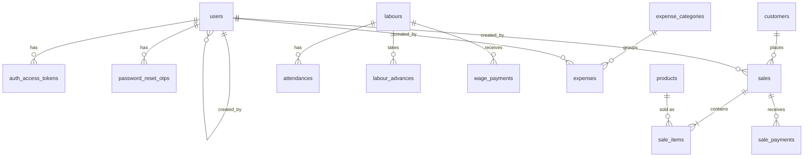

# 05 · Backend Schema: FlyAsh

| | |
|---|---|
| **Document** | Database schema + API data contracts |
| **Version** | 1.0 |
| **Date** | 2026-11-08 |
| **Database** | MariaDB (dev: XAMPP 10.4+, prod: 11.4 LTS), `utf8mb4_unicode_ci` |
| **Related docs** | 01-PRD (business rules §6) · 02-TRD (API standards §4) |

---

## 1. Conventions

| Item | Rule |
|---|---|
| Primary key | `id INT UNSIGNED AUTO_INCREMENT` (Lucid `increments`) |
| Names | `snake_case`, plural tables, FK = `<singular>_id` |
| Money | `DECIMAL(12,2)`, never FLOAT. Max ₹9,99,99,99,999.99 |
| Quantity | `DECIMAL(12,2)` |
| Dates | `DATE` for business dates (sale date, attendance date …) in factory local time (IST) |
| Timestamps | `created_at`, `updated_at` as `DATETIME`, stored in **UTC** |
| Enums | `VARCHAR(20)` + validation in VineJS (easier to change than MariaDB `ENUM`) |
| Booleans | `TINYINT(1)` (`is_active`) |
| Foreign keys | `ON DELETE RESTRICT ON UPDATE CASCADE`, except child rows of a sale (`CASCADE`) |
| Audit | `created_by INT UNSIGNED NULL → users.id` on business tables (hidden in JSON; the `creator` relation is serialized as `created_by: { id, name }`) |
| Soft delete | `deleted_at` on `sales`. `is_active` on master data |
| Migrations | One Lucid migration per table. Schema changes only via new migrations |

`adonis_schema` and `adonis_schema_versions` are created by Lucid automatically. The login rate limiter uses the **memory store** (one API process), so it needs no table.

## 2. Entity Relationship Diagram



All tables: `users` · `auth_access_tokens` · `password_reset_otps` · `factory_settings` · `products` · `customers` · `sales` · `sale_items` · `sale_payments` · `labours` · `attendances` · `labour_advances` · `wage_payments` · `expense_categories` · `expenses` · `app_versions`

---

## 3. Tables

### 3.1 `users`

| Column | Type | Null | Default | Notes |
|---|---|---|---|---|
| id | INT UNSIGNED PK | | AI | |
| name | VARCHAR(100) | no | | |
| phone | VARCHAR(15) | no | | **unique**, 10 digits, login id |
| email | VARCHAR(150) | yes | NULL | **unique**, login id + OTP reset |
| password | VARCHAR(255) | no | | scrypt hash |
| locale | VARCHAR(5) | no | 'en' | `en` · `bn`. Language for emails and API messages (when no `Accept-Language` header) |
| is_active | TINYINT(1) | no | 1 | |
| last_login_at | DATETIME | yes | NULL | |
| created_by | INT UNSIGNED FK → users.id | yes | NULL | NULL for the first user |
| created_at / updated_at | DATETIME | no | | |

### 3.2 `auth_access_tokens` *(standard @adonisjs/auth table)*

| Column | Type | Null | Notes |
|---|---|---|---|
| id | INT UNSIGNED PK | | |
| tokenable_id | INT UNSIGNED FK → users.id | no | `ON DELETE CASCADE` |
| type | VARCHAR(255) | no | `auth_token` |
| name | VARCHAR(255) | yes | Device name (e.g. "Android", "Windows", "Web") |
| hash | VARCHAR(255) | no | **unique**, hash of the token |
| abilities | TEXT | no | `["*"]` |
| last_used_at | DATETIME | yes | |
| expires_at | DATETIME | yes | Always **NULL** (no expiry) |
| created_at / updated_at | DATETIME | yes | |

### 3.3 `password_reset_otps`

| Column | Type | Null | Default | Notes |
|---|---|---|---|---|
| id | INT UNSIGNED PK | | AI | Put inside the signed reset token as `otp_id` |
| user_id | INT UNSIGNED FK → users.id | no | | `ON DELETE CASCADE`, index |
| otp_hash | VARCHAR(255) | no | | Hash of the 6-digit OTP |
| attempts | TINYINT UNSIGNED | no | 0 | Deleted at 5 |
| expires_at | DATETIME | no | | now + 10 min |
| verified_at | DATETIME | yes | NULL | Set when the OTP is correct |
| created_at / updated_at | DATETIME | no | | |

The row is deleted after a successful reset, so the reset token is single use. Older rows for the same user are deleted when a new OTP is requested.

### 3.4 `factory_settings` *(always exactly 1 row, id = 1)*

| Column | Type | Null | Default | Notes |
|---|---|---|---|---|
| id | INT UNSIGNED PK | | 1 | |
| factory_name | VARCHAR(150) | no | 'My Brick Factory' | App header, receipts, OTP email |
| owner_name | VARCHAR(100) | yes | NULL | |
| phone | VARCHAR(15) | yes | NULL | |
| email | VARCHAR(150) | yes | NULL | |
| address | VARCHAR(500) | yes | NULL | |
| invoice_prefix | VARCHAR(10) | no | 'INV-' | |
| updated_by | INT UNSIGNED FK → users.id | yes | NULL | |
| created_at / updated_at | DATETIME | no | | |

### 3.5 `products`

| Column | Type | Null | Default | Notes |
|---|---|---|---|---|
| id | INT UNSIGNED PK | | AI | |
| name | VARCHAR(100) | no | | **unique** |
| unit | VARCHAR(20) | no | 'piece' | `piece` · `thousand` · `truck` · `other` |
| unit_label | VARCHAR(30) | yes | NULL | Required when `unit = other` (e.g. "cft") |
| default_cost | DECIMAL(12,2) | no | 0.00 | Production cost per unit |
| default_price | DECIMAL(12,2) | no | 0.00 | Selling price per unit |
| notes | VARCHAR(500) | yes | NULL | |
| is_active | TINYINT(1) | no | 1 | index |
| created_by | INT UNSIGNED FK → users.id | yes | NULL | |
| created_at / updated_at | DATETIME | no | | |

### 3.6 `customers`

| Column | Type | Null | Default | Notes |
|---|---|---|---|---|
| id | INT UNSIGNED PK | | AI | |
| name | VARCHAR(100) | no | | index |
| phone | VARCHAR(15) | no | | **unique** |
| address | VARCHAR(500) | yes | NULL | |
| is_active | TINYINT(1) | no | 1 | |
| created_by | INT UNSIGNED FK → users.id | yes | NULL | |
| created_at / updated_at | DATETIME | no | | |

Customer totals (`total_sales`, `total_paid`, `total_due`) are **calculated** from `sales` in queries, not stored.

### 3.7 `sales`

| Column | Type | Null | Default | Notes |
|---|---|---|---|---|
| id | INT UNSIGNED PK | | AI | |
| invoice_no | VARCHAR(20) | yes | NULL | **unique**. Set right after insert: `invoice_prefix + LPAD(id, 6, '0')` → `INV-000001` |
| type | VARCHAR(20) | no | | `instant` · `booking` |
| status | VARCHAR(20) | no | | `booked` · `delivered` · `cancelled` (instant → `delivered`) |
| customer_id | INT UNSIGNED FK → customers.id | no | | index |
| sale_date | DATE | no | | The day the sale or booking was made |
| delivery_date | DATE | yes | NULL | Booking: expected delivery date |
| delivered_date | DATE | yes | NULL | Date it was delivered (instant: = `sale_date`). **Used by all sales and profit reports** |
| delivery_address | VARCHAR(500) | yes | NULL | |
| subtotal | DECIMAL(12,2) | no | 0.00 | Σ `sale_items.line_total` |
| transport_charge | DECIMAL(12,2) | no | 0.00 | |
| discount | DECIMAL(12,2) | no | 0.00 | |
| total | DECIMAL(12,2) | no | 0.00 | `subtotal + transport_charge − discount` |
| total_cost | DECIMAL(12,2) | no | 0.00 | Σ `sale_items.line_cost` |
| profit | DECIMAL(12,2) | no | 0.00 | `total − total_cost` |
| paid_amount | DECIMAL(12,2) | no | 0.00 | Σ `sale_payments.amount` |
| due_amount | DECIMAL(12,2) | no | 0.00 | `total − paid_amount` |
| payment_status | VARCHAR(20) | no | 'due' | `paid` · `partial` · `due` |
| notes | VARCHAR(1000) | yes | NULL | |
| cancelled_at | DATETIME | yes | NULL | |
| created_by | INT UNSIGNED FK → users.id | yes | NULL | |
| created_at / updated_at | DATETIME | no | | |
| deleted_at | DATETIME | yes | NULL | Soft delete. All queries filter `deleted_at IS NULL` |

**Indexes:** `(status, delivered_date)`, `(status, delivery_date)`, `(payment_status)`, `(sale_date)`, `(customer_id)`, `(deleted_at)`.
`total`, `total_cost`, `profit`, `paid_amount`, `due_amount` and `payment_status` are written **only** by `SaleService.recalculate()`.

### 3.8 `sale_items`

| Column | Type | Null | Default | Notes |
|---|---|---|---|---|
| id | INT UNSIGNED PK | | AI | |
| sale_id | INT UNSIGNED FK → sales.id | no | | `ON DELETE CASCADE`, index |
| product_id | INT UNSIGNED FK → products.id | no | | index |
| product_name | VARCHAR(100) | no | | Snapshot (receipt stays the same if the product is renamed) |
| unit | VARCHAR(30) | no | | Snapshot of the unit label |
| quantity | DECIMAL(12,2) | no | | > 0 |
| unit_cost | DECIMAL(12,2) | no | | Snapshot, editable in the sale form |
| unit_price | DECIMAL(12,2) | no | | Snapshot, editable in the sale form |
| line_cost | DECIMAL(12,2) | no | | `quantity × unit_cost` |
| line_total | DECIMAL(12,2) | no | | `quantity × unit_price` |
| created_at / updated_at | DATETIME | no | | |

### 3.9 `sale_payments`

| Column | Type | Null | Default | Notes |
|---|---|---|---|---|
| id | INT UNSIGNED PK | | AI | |
| sale_id | INT UNSIGNED FK → sales.id | no | | `ON DELETE CASCADE`, index |
| amount | DECIMAL(12,2) | no | | > 0, cannot make paid > total |
| payment_date | DATE | no | | index (collections report) |
| method | VARCHAR(20) | no | 'cash' | `cash` · `upi` · `bank` · `other` |
| note | VARCHAR(500) | yes | NULL | |
| created_by | INT UNSIGNED FK → users.id | yes | NULL | |
| created_at / updated_at | DATETIME | no | | |

### 3.10 `labours`

| Column | Type | Null | Default | Notes |
|---|---|---|---|---|
| id | INT UNSIGNED PK | | AI | |
| name | VARCHAR(100) | no | | index |
| phone | VARCHAR(15) | yes | NULL | |
| address | VARCHAR(500) | yes | NULL | |
| wage_type | VARCHAR(20) | no | | `daily` · `monthly` |
| wage_amount | DECIMAL(12,2) | no | | ₹ per day or per month |
| joining_date | DATE | no | | |
| left_date | DATE | yes | NULL | Set on deactivate |
| is_active | TINYINT(1) | no | 1 | index |
| created_by | INT UNSIGNED FK → users.id | yes | NULL | |
| created_at / updated_at | DATETIME | no | | |

### 3.11 `attendances`

| Column | Type | Null | Default | Notes |
|---|---|---|---|---|
| id | INT UNSIGNED PK | | AI | |
| labour_id | INT UNSIGNED FK → labours.id | no | | |
| date | DATE | no | | ≤ today |
| status | VARCHAR(20) | no | | `present` · `half_day` · `absent` |
| wage_type | VARCHAR(20) | no | | Snapshot from the labour on save |
| wage_amount | DECIMAL(12,2) | no | | Snapshot from the labour on save |
| created_by | INT UNSIGNED FK → users.id | yes | NULL | Last user who saved this day |
| created_at / updated_at | DATETIME | no | | |

**Unique:** `(labour_id, date)`. **Index:** `(date)`. "Not marked" = no row.

### 3.12 `labour_advances`

| Column | Type | Null | Default | Notes |
|---|---|---|---|---|
| id | INT UNSIGNED PK | | AI | |
| labour_id | INT UNSIGNED FK → labours.id | no | | index |
| amount | DECIMAL(12,2) | no | | > 0 |
| advance_date | DATE | no | | Deducted in the month of this date. index |
| note | VARCHAR(500) | yes | NULL | |
| created_by | INT UNSIGNED FK → users.id | yes | NULL | |
| created_at / updated_at | DATETIME | no | | |

### 3.13 `wage_payments`

| Column | Type | Null | Default | Notes |
|---|---|---|---|---|
| id | INT UNSIGNED PK | | AI | |
| labour_id | INT UNSIGNED FK → labours.id | no | | |
| wage_month | DATE | no | | First day of the month being paid (`2026-11-01`) |
| amount | DECIMAL(12,2) | no | | > 0 |
| payment_date | DATE | no | | |
| method | VARCHAR(20) | no | 'cash' | `cash` · `upi` · `bank` · `other` |
| note | VARCHAR(500) | yes | NULL | |
| created_by | INT UNSIGNED FK → users.id | yes | NULL | |
| created_at / updated_at | DATETIME | no | | |

**Index:** `(labour_id, wage_month)`.

### 3.14 `expense_categories`

| Column | Type | Null | Default | Notes |
|---|---|---|---|---|
| id | INT UNSIGNED PK | | AI | |
| name | VARCHAR(50) | no | | **unique** |
| icon | VARCHAR(30) | yes | NULL | Icon key for the app (e.g. `utensils`, `wrench`) |
| is_active | TINYINT(1) | no | 1 | |
| sort_order | INT | no | 0 | |
| created_at / updated_at | DATETIME | no | | |

**Seed:** Labour Tiffin (`utensils`) · Machine Repair (`wrench`) · Diesel / Fuel (`fuel`) · Electricity Bill (`zap`) · Transport (`truck`) · Others (`circle-dot`).

### 3.15 `expenses`

| Column | Type | Null | Default | Notes |
|---|---|---|---|---|
| id | INT UNSIGNED PK | | AI | |
| expense_category_id | INT UNSIGNED FK → expense_categories.id | no | | index |
| expense_date | DATE | no | | index |
| amount | DECIMAL(12,2) | no | | > 0 |
| note | VARCHAR(500) | yes | NULL | |
| created_by | INT UNSIGNED FK → users.id | yes | NULL | |
| created_at / updated_at | DATETIME | no | | |

### 3.16 `app_versions`

| Column | Type | Null | Default | Notes |
|---|---|---|---|---|
| id | INT UNSIGNED PK | | AI | |
| platform | VARCHAR(20) | no | | `android` · `windows` · `web` |
| version_name | VARCHAR(20) | no | | `1.2.0` |
| build_number | INT UNSIGNED | no | | `12` |
| min_supported_build | INT UNSIGNED | no | | Builds below this are forced to update |
| download_url | VARCHAR(500) | yes | NULL | NULL for web |
| release_notes | TEXT | yes | NULL | |
| is_active | TINYINT(1) | no | 1 | |
| created_at / updated_at | DATETIME | no | | |

**Unique:** `(platform, build_number)`. The latest = highest active `build_number` for the platform.

---

## 4. Key Calculations (server)

### 4.1 `SaleService.recalculate(sale)`, run in the same transaction after any item or payment change

```
for each item: line_total = quantity × unit_price ; line_cost = quantity × unit_cost
subtotal    = Σ line_total
total       = subtotal + transport_charge − discount          (reject if < 0)
total_cost  = Σ line_cost
profit      = total − total_cost
paid_amount = Σ payments.amount                               (reject if > total)
due_amount  = total − paid_amount
payment_status = paid_amount = 0 ? 'due' : (due_amount = 0 ? 'paid' : 'partial')
```

### 4.2 Monthly wage sheet (`WageService`)

```sql
SELECT a.labour_id,
  SUM(a.status = 'present')                           AS present_days,
  SUM(a.status = 'half_day')                          AS half_days,
  SUM(a.status = 'absent')                            AS absent_days,
  SUM(CASE a.status WHEN 'present' THEN 1 WHEN 'half_day' THEN 0.5 ELSE 0 END) AS worked_days,
  SUM(CASE a.status WHEN 'present' THEN 1 WHEN 'half_day' THEN 0.5 ELSE 0 END
      * IF(a.wage_type = 'daily', a.wage_amount, a.wage_amount / DAY(LAST_DAY(a.date)))) AS earned
FROM attendances a
WHERE a.date BETWEEN :month_start AND :month_end
GROUP BY a.labour_id;
```

- `advances` = Σ `labour_advances.amount` where `advance_date` is in the month
- `paid` = Σ `wage_payments.amount` where `wage_month = :month_start`
- `balance = earned − advances − paid`, and `not_marked_days` = active days in the month up to today − marked rows
- `status`: earned > 0 and advances + paid = 0 → `due` · balance > 0 → `partial` · balance ≤ 0 → `paid`
- Money is rounded to 2 decimals at the end (`ROUND(earned, 2)`).

### 4.3 Net profit for a period

```
sales_profit = Σ sales.profit   WHERE status='delivered' AND deleted_at IS NULL AND delivered_date BETWEEN from AND to
expenses     = Σ expenses.amount WHERE expense_date BETWEEN from AND to
wages        = Σ earned (formula 4.2) WHERE attendances.date BETWEEN from AND to
net_profit   = sales_profit − expenses − wages
```

### 4.4 Customer due

```
total_due = Σ sales.due_amount WHERE customer_id = :id AND status='delivered' AND deleted_at IS NULL
```

---

## 5. API Data Contracts

All responses use the envelope from 02-TRD §4.2: `{ success, status_code, message, data }`. The objects below show what goes inside `data` (a single object, or each element of `data.items` in paginated lists). Money is a string with 2 decimals.

### 5.1 Auth & profile

| Endpoint | Request body | `data` |
|---|---|---|
| `POST /auth/login` | `{ login, password }` (login = phone or email) | `{ token, user: User }` |
| `GET /auth/me` | — | `User` |
| `PUT /auth/me` | `{ name, phone, email? }` | `User` |
| `PUT /auth/password` | `{ current_password, password, password_confirmation }` | `null` |
| `PUT /auth/locale` | `{ locale }` (`en` \| `bn`) | `User` |
| `POST /auth/logout` | — | `null` |
| `POST /auth/forgot-password` | `{ email }` | `null` |
| `POST /auth/verify-otp` | `{ email, otp }` | `{ reset_token }` |
| `POST /auth/reset-password` | `{ reset_token, password, password_confirmation }` | `null` |

```jsonc
// User
{ "id": 1, "name": "Rahim Sheikh", "phone": "9876543210", "email": "rahim@gmail.com",
  "locale": "en", "is_active": true, "last_login_at": "2026-11-08T05:10:00.000Z", "created_at": "2026-11-01T04:00:00.000Z" }
```

### 5.2 Users

| Endpoint | Request body | `data` |
|---|---|---|
| `GET /users?page&limit&search&active` | — | Paginated `User` (excludes the current user) |
| `POST /users` | `{ name, phone, email?, password, locale? }` | `User` |
| `GET /users/:id` · `PUT /users/:id` | `{ name, phone, email? }` | `User` |
| `PATCH /users/:id/status` | `{ is_active }` | `User` |
| `PUT /users/:id/password` | `{ password, password_confirmation }` | `null` |

### 5.3 Products

| Endpoint | Request body | `data` |
|---|---|---|
| `GET /products?page&limit&search&active` | — | Paginated `Product` |
| `POST /products` · `PUT /products/:id` | `{ name, unit, unit_label?, default_cost, default_price, notes? }` | `Product` |
| `PATCH /products/:id/status` | `{ is_active }` | `Product` |
| `DELETE /products/:id` | — | `null` (409 if used in a sale) |

```jsonc
// Product
{ "id": 3, "name": "Fly Ash Brick 9×4×3", "unit": "piece", "unit_label": null,
  "default_cost": "4.20", "default_price": "6.50", "margin": "2.30", "notes": null, "is_active": true }
```

### 5.4 Customers

| Endpoint | Request body | `data` |
|---|---|---|
| `GET /customers?page&limit&search&has_due` | — | Paginated `Customer` |
| `POST /customers` · `PUT /customers/:id` | `{ name, phone, address? }` | `Customer` (422 on duplicate phone, with `existing_customer_id` in the error) |
| `GET /customers/:id` | — | `Customer` |
| `DELETE /customers/:id` | — | `null` (409 if they have sales) |
| `GET /customers/:id/sales?page&limit` | — | Paginated `SaleListItem` |

```jsonc
// Customer
{ "id": 12, "name": "Rahim Traders", "phone": "9876543210", "address": "Barasat, North 24 Pgs",
  "is_active": true, "total_sales": "185000.00", "total_paid": "180500.00", "total_due": "4500.00" }
```

### 5.5 Sales

**Create / update body**

```jsonc
{
  "type": "booking",                       // instant | booking
  "customer_id": 12,                       // OR "new_customer": { "name", "phone", "address" }
  "sale_date": "2026-11-08",
  "delivery_date": "2026-11-12",           // booking only (required)
  "delivery_address": "Barasat",           // optional
  "items": [
    { "product_id": 3, "quantity": "5000", "unit_cost": "4.20", "unit_price": "6.50" }
  ],
  "transport_charge": "1500.00",
  "discount": "500.00",
  "payment": { "amount": "10000.00", "method": "upi", "note": "Advance" },   // create only, optional
  "notes": "Deliver before noon"
}
```

| Endpoint | Request body | `data` |
|---|---|---|
| `GET /sales?page&limit&search&type&status&from&to` | — | Paginated `SaleListItem` (`status` filter accepts `paid`/`partial`/`due`/`booked`/`cancelled`) |
| `POST /sales` | body above | `Sale` |
| `GET /sales/:id` | — | `Sale` |
| `PUT /sales/:id` | body above without `payment` | `Sale` |
| `DELETE /sales/:id` | — | `null` (soft delete) |
| `POST /sales/:id/deliver` | `{ delivered_date }` | `Sale` |
| `POST /sales/:id/cancel` | — | `Sale` (400 if it has payments) |
| `POST /sales/:id/payments` | `{ amount, payment_date, method, note? }` | `Sale` |
| `DELETE /sales/:id/payments/:paymentId` | — | `Sale` |
| `GET /sales/upcoming-deliveries?page&limit` | — | Paginated `SaleListItem` + `is_overdue` |

```jsonc
// SaleListItem
{ "id": 101, "invoice_no": "INV-000101", "type": "booking", "status": "booked", "payment_status": "partial",
  "customer": { "id": 12, "name": "Rahim Traders", "phone": "9876543210" },
  "sale_date": "2026-11-08", "delivery_date": "2026-11-12", "delivered_date": null,
  "total": "33500.00", "profit": "12500.00", "paid_amount": "10000.00", "due_amount": "23500.00" }

// Sale = SaleListItem + 
{ "delivery_address": "Barasat", "subtotal": "32500.00", "transport_charge": "1500.00", "discount": "500.00",
  "total_cost": "21000.00", "notes": "Deliver before noon",
  "items": [ { "id": 1, "product_id": 3, "product_name": "Fly Ash Brick 9×4×3", "unit": "piece",
               "quantity": "5000.00", "unit_cost": "4.20", "unit_price": "6.50",
               "line_cost": "21000.00", "line_total": "32500.00" } ],
  "payments": [ { "id": 7, "amount": "10000.00", "payment_date": "2026-11-08", "method": "upi",
                  "note": "Advance", "created_by": { "id": 1, "name": "Rahim Sheikh" } } ],
  "created_by": { "id": 1, "name": "Rahim Sheikh" }, "created_at": "2026-11-08T06:30:00.000Z" }
```

### 5.6 Labours, attendance, wages

| Endpoint | Request body | `data` |
|---|---|---|
| `GET /labours?page&limit&search&active` | — | Paginated `Labour` |
| `POST /labours` · `PUT /labours/:id` | `{ name, phone?, address?, wage_type, wage_amount, joining_date }` | `Labour` |
| `GET /labours/:id` | — | `Labour` |
| `PATCH /labours/:id/status` | `{ is_active, left_date? }` | `Labour` |
| `GET /attendance?date` | — | `AttendanceDay` |
| `PUT /attendance` | `{ date, records: [{ labour_id, status }] }` | `AttendanceDay` |
| `GET /labours/:id/attendance?month=2026-11` | — | `{ month, days: [{ date, status }] , summary }` |
| `GET /wages?month&page&limit` | — | Paginated `WageRow` + `totals` |
| `GET /labours/:id/wages?month` | — | `WageRow` + `days[]`, `advances[]`, `payments[]` |
| `GET /labours/:id/advances?page&limit` · `POST` | `{ amount, advance_date, note? }` | Paginated / `Advance` |
| `DELETE /advances/:id` | — | `null` |
| `POST /labours/:id/wage-payments` | `{ wage_month: "2026-11", amount, payment_date, method, note? }` | `WagePayment` |
| `DELETE /wage-payments/:id` | — | `null` |

```jsonc
// Labour
{ "id": 5, "name": "Kartik Mondal", "phone": "9123456780", "address": null, "wage_type": "daily",
  "wage_amount": "500.00", "joining_date": "2026-06-01", "left_date": null, "is_active": true,
  "today_status": "present" }

// AttendanceDay (not paginated: all labours active on that date)
{ "date": "2026-11-08",
  "summary": { "total": 15, "present": 12, "half_day": 1, "absent": 1, "not_marked": 1 },
  "items": [ { "labour_id": 5, "name": "Kartik Mondal", "wage_type": "daily", "status": "present" },
             { "labour_id": 6, "name": "Sujit Das", "wage_type": "monthly", "status": null } ] }

// WageRow
{ "labour_id": 5, "name": "Kartik Mondal", "wage_type": "daily", "wage_amount": "500.00",
  "present_days": 22, "half_days": 2, "absent_days": 3, "not_marked_days": 0, "worked_days": "23.00",
  "earned": "11500.00", "advances": "2000.00", "paid": "5000.00", "balance": "4500.00", "status": "partial" }
```

### 5.7 Expenses

| Endpoint | Request body | `data` |
|---|---|---|
| `GET /expenses?page&limit&from&to&category_id` | — | Paginated `Expense` + `period_total` |
| `POST /expenses` · `PUT /expenses/:id` | `{ expense_category_id, expense_date, amount, note? }` | `Expense` |
| `GET /expenses/:id` · `DELETE /expenses/:id` | — | `Expense` / `null` |
| `GET /expense-categories?active` | — | `ExpenseCategory[]` (not paginated, small list) |
| `POST /expense-categories` · `PUT /expense-categories/:id` | `{ name, icon?, is_active? }` | `ExpenseCategory` |

```jsonc
// Expense
{ "id": 40, "expense_date": "2026-11-08", "amount": "850.00", "note": "Tiffin for 15 labours",
  "category": { "id": 1, "name": "Labour Tiffin", "icon": "utensils" },
  "created_by": { "id": 1, "name": "Rahim Sheikh" } }
```

For a paginated list with an extra total, `data` is `{ items, page, limit, total, last_page, period_total }`.

### 5.8 Dashboard

```jsonc
// GET /dashboard
{ "today_sales": { "amount": "48500.00", "count": 6 }, "today_profit": "15200.00",
  "total_due": "126400.00", "deliveries_today": 3, "overdue_deliveries": 1,
  "present_today": 13, "labours_total": 15, "month_expenses": "18250.00",
  "recent_sales": [ /* 5 × SaleListItem */ ] }
```

### 5.9 Reports

| Endpoint | `data` |
|---|---|
| `GET /reports/sales?from&to` | `{ count, amount, cost, profit, by_product: [{ product_id, product_name, quantity, amount, profit }], daily: [{ date, amount, profit }] }` |
| `GET /reports/dues?page&limit` | Paginated `{ customer_id, name, phone, total_due, oldest_due_date }` + `grand_total` |
| `GET /reports/expenses?from&to` | `{ total, by_category: [{ category_id, name, amount, percent }] }` |
| `GET /reports/wages?month` | `{ earned, advances, paid, balance, rows: WageRow[] }` |
| `GET /reports/net-profit?from&to` | `{ sales_profit, expenses, wages, net_profit, monthly: [{ month, sales_profit, expenses, wages, net_profit }] }` |
| `GET /reports/collections?from&to` | `{ total, by_method: [{ method, amount }], daily: [{ date, amount }] }` |

### 5.10 Settings, app version

| Endpoint | Request body | `data` |
|---|---|---|
| `GET /settings/factory` · `PUT /settings/factory` | `{ factory_name, owner_name?, phone?, email?, address?, invoice_prefix? }` | `{ …fields }` |
| 🌐 `GET /app/version?platform&build` | — | `{ latest_version, latest_build, update_available, force_update, download_url, release_notes }` |
| 🌐 `GET /health` | — | `{ status: "ok", db: "ok", time }` |

---

## 6. Validation Rules (main)

| Field | Rule |
|---|---|
| phone | Exactly 10 digits, starts with 6–9 |
| email | Valid email, lower-cased, trimmed |
| password | 6–64 characters |
| money fields | ≥ 0 (amounts of payments, advances, expenses: > 0), max 2 decimals |
| quantity | > 0, max 2 decimals |
| dates | `YYYY-MM-DD`. Attendance, payments, advances and expenses cannot be in the future |
| sale | ≥ 1 item. Booking needs `delivery_date ≥ sale_date`. `discount ≤ subtotal + transport_charge` |
| names | Trimmed, 1–100 characters |
| `limit` | 1–100, default 20. `page` ≥ 1 |

## 7. Seed Data

| Seeder | Content | Environment |
|---|---|---|
| `expense_category_seeder` | The 6 default categories | all |
| `factory_settings_seeder` | One row with defaults | all |
| `dev_sample_seeder` | 5 products, 30 customers, 80 sales, 12 labours with 2 months of attendance, 50 expenses | development only |

The first user is **not** seeded. It is created with `node ace user:create`.
