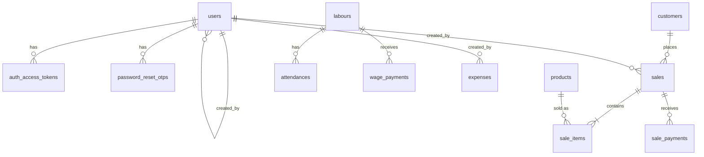

# 05 · Backend Schema: FlyAsh

| | |
|---|---|
| **Document** | Database schema + API data contracts |
| **Version** | 1.0 |
| **Date** | 2026-11-08 |
| **Database** | MariaDB (dev: XAMPP 10.4+, prod: 11.4 LTS), `utf8mb4_unicode_ci` |
| **Related docs** | 01-PRD (business rules §6) · 02-TRD (API standards §4) |

---

## 1. Conventions

| Item | Rule |
|---|---|
| Primary key | `id CHAR(36)` UUID v7, set by the app before insert (`withUuid` mixin in `app/models/mixins`). Time ordered, so `ORDER BY id` is creation order. Exception: `auth_access_tokens.id` stays `INT AUTO_INCREMENT` because the Adonis token value embeds it |
| Names | `snake_case`, plural tables, FK = `<singular>_id` |
| Money | `DECIMAL(12,2)`, never FLOAT. Max ₹9,99,99,99,999.99 |
| Quantity | `DECIMAL(12,2)` |
| Dates | `DATE` for business dates (sale date, attendance date …) in factory local time (IST), returned as `YYYY-MM-DD` strings (never timezone-converted; see 02-TRD §4.3) |
| Timestamps | `created_at`, `updated_at` as `DATETIME`, stored in **UTC** |
| Enums | `VARCHAR(20)` + validation in VineJS (easier to change than MariaDB `ENUM`) |
| Booleans | `TINYINT(1)` (`is_active`) |
| Foreign keys | `ON DELETE RESTRICT ON UPDATE CASCADE`, except child rows of a sale (`CASCADE`) |
| Audit | `created_by CHAR(36) NULL → users.id` on business tables (hidden in JSON; the `creator` relation is serialized as `created_by: { id, name }`) |
| Soft delete | `deleted_at` on `sales`. `is_active` on master data |
| Migrations | One Lucid migration per table. Schema changes only via new migrations |

`adonis_schema` and `adonis_schema_versions` are created by Lucid automatically. The login rate limiter uses the **memory store** (one API process), so it needs no table.

## 2. Entity Relationship Diagram



All tables: `users` · `auth_access_tokens` · `password_reset_otps` · `factory_settings` · `products` · `customers` · `sales` · `sale_items` · `sale_payments` · `labours` · `attendances` · `wage_payments` · `expenses` · `app_versions`

---

## 3. Tables

### 3.1 `users`

| Column | Type | Null | Default | Notes |
|---|---|---|---|---|
| id | CHAR(36) PK (UUID v7) | | app | |
| name | VARCHAR(100) | no | | |
| phone | VARCHAR(15) | no | | **unique**, 10 digits, login id |
| email | VARCHAR(150) | yes | NULL | **unique**, login id + OTP reset |
| password | VARCHAR(255) | no | | scrypt hash |
| locale | VARCHAR(5) | no | 'en' | `en` · `bn`. Language for emails and API messages (when no `Accept-Language` header) |
| theme_mode | VARCHAR(10) | no | 'system' | `system` · `light` · `dark` |
| accent_color | VARCHAR(20) | no | 'brick' (migration 0026; was 'blue') | `blue` · `brick` · `emerald` · `violet` · `slate` (04-UI-UX §5.2) |
| is_active | TINYINT(1) | no | 1 | |
| last_login_at | DATETIME | yes | NULL | |
| created_by | CHAR(36) FK → users.id | yes | NULL | NULL for the first user |
| created_at / updated_at | DATETIME | no | | |

### 3.2 `auth_access_tokens` *(standard @adonisjs/auth table)*

| Column | Type | Null | Notes |
|---|---|---|---|
| id | INT UNSIGNED PK | | | AUTO_INCREMENT (library) |
| tokenable_id | CHAR(36) FK → users.id | no | `ON DELETE CASCADE` |
| type | VARCHAR(255) | no | `auth_token` |
| name | VARCHAR(255) | yes | Device name (e.g. "Android", "Windows", "Web") |
| hash | VARCHAR(255) | no | **unique**, hash of the token |
| abilities | TEXT | no | `["*"]` |
| last_used_at | DATETIME | yes | |
| expires_at | DATETIME | yes | Always **NULL** (no expiry) |
| created_at / updated_at | DATETIME | yes | |

### 3.3 `password_reset_otps`

| Column | Type | Null | Default | Notes |
|---|---|---|---|---|
| id | CHAR(36) PK (UUID v7) | | app | Put inside the signed reset token as `otp_id` |
| user_id | CHAR(36) FK → users.id | no | | `ON DELETE CASCADE`, index |
| otp_hash | VARCHAR(255) | no | | Hash of the 6-digit OTP |
| attempts | TINYINT UNSIGNED | no | 0 | Deleted at 5 |
| expires_at | DATETIME | no | | now + 10 min |
| verified_at | DATETIME | yes | NULL | Set when the OTP is correct |
| created_at / updated_at | DATETIME | no | | |

The row is deleted after a successful reset, so the reset token is single use. Older rows for the same user are deleted when a new OTP is requested.

### 3.4 `factory_settings` *(always exactly 1 row, id = 1)*

| Column | Type | Null | Default | Notes |
|---|---|---|---|---|
| id | CHAR(36) PK (UUID v7) | | app | |
| factory_name | VARCHAR(150) | no | 'My Brick Factory' | App header, receipts, OTP email |
| owner_name | VARCHAR(100) | yes | NULL | |
| phone | VARCHAR(15) | yes | NULL | |
| email | VARCHAR(150) | yes | NULL | |
| address | VARCHAR(500) | yes | NULL | |
| gst_number | VARCHAR(15) | yes | NULL | Optional GSTIN (e.g. `19ABCDE1234F1Z5`), upper case; printed on receipts (migration 0027) |
| invoice_prefix | VARCHAR(10) | no | 'INV-' | |
| last_invoice_no | INT UNSIGNED | no | 0 | Counter for invoice numbers; locked (`FOR UPDATE`) and +1 inside the sale transaction |
| updated_by | CHAR(36) FK → users.id | yes | NULL | |
| created_at / updated_at | DATETIME | no | | |

### 3.5 `products`

| Column | Type | Null | Default | Notes |
|---|---|---|---|---|
| id | CHAR(36) PK (UUID v7) | | app | |
| name | VARCHAR(100) | no | | **unique** |
| default_price | DECIMAL(12,2) | no | 0.00 | Selling price per unit |
| notes | VARCHAR(500) | yes | NULL | |
| is_active | TINYINT(1) | no | 1 | index |
| created_by | CHAR(36) FK → users.id | yes | NULL | |
| created_at / updated_at | DATETIME | no | | |

### 3.6 `customers`

| Column | Type | Null | Default | Notes |
|---|---|---|---|---|
| id | CHAR(36) PK (UUID v7) | | app | |
| name | VARCHAR(100) | no | | index |
| phone | VARCHAR(15) | yes | NULL | Optional; **unique** when given (migration 0022) |
| address | VARCHAR(500) | yes | NULL | |
| is_active | TINYINT(1) | no | 1 | |
| created_by | CHAR(36) FK → users.id | yes | NULL | |
| created_at / updated_at | DATETIME | no | | |

Customer totals (`total_sales`, `total_paid`, `total_due`, `sales_count`) are **calculated** from `sales` in queries, not stored: delivered sales and open bookings (see 4.4).

### 3.7 `sales`

| Column | Type | Null | Default | Notes |
|---|---|---|---|---|
| id | CHAR(36) PK (UUID v7) | | app | |
| invoice_no | VARCHAR(20) | yes | NULL | **unique**. `invoice_prefix + LPAD(last_invoice_no + 1, 6, '0')` → `INV-000001` (ids are UUIDs, so the number comes from the settings counter) |
| type | VARCHAR(20) | no | | `instant` · `booking` |
| status | VARCHAR(20) | no | | `booked` · `delivered` · `cancelled` (instant → `delivered`) |
| customer_id | CHAR(36) FK → customers.id | no | | index |
| sale_date | DATE | no | | The day the sale or booking was made |
| delivery_date | DATE | yes | NULL | Booking: expected delivery date |
| delivered_date | DATE | yes | NULL | Date it was delivered (instant: = `sale_date`). **Used by all sales reports** |
| delivery_address | VARCHAR(500) | yes | NULL | |
| subtotal | DECIMAL(12,2) | no | 0.00 | Σ `sale_items.line_total` |
| transport_charge | DECIMAL(12,2) | no | 0.00 | |
| discount | DECIMAL(12,2) | no | 0.00 | |
| tax_percent | DECIMAL(5,2) | no | 0.00 | 0–100, of (subtotal + transport − discount) (migration 0021) |
| tax_amount | DECIMAL(12,2) | no | 0.00 | Rounded to paise. total = subtotal + transport − discount + tax |
| total | DECIMAL(12,2) | no | 0.00 | `subtotal + transport_charge − discount` |
| paid_amount | DECIMAL(12,2) | no | 0.00 | Σ `sale_payments.amount` |
| due_amount | DECIMAL(12,2) | no | 0.00 | `total − paid_amount` |
| payment_status | VARCHAR(20) | no | 'due' | `paid` · `partial` · `due` |
| notes | VARCHAR(1000) | yes | NULL | |
| cancelled_at | DATETIME | yes | NULL | |
| created_by | CHAR(36) FK → users.id | yes | NULL | |
| created_at / updated_at | DATETIME | no | | |
| deleted_at | DATETIME | yes | NULL | Soft delete. All queries filter `deleted_at IS NULL` |

**Indexes:** `(status, delivered_date)`, `(status, delivery_date)`, `(payment_status)`, `(sale_date)`, `(customer_id)`, `(deleted_at)`; since migration 0028 also `(deleted_at, sale_date, id)` (the sales list), `(type, sale_date)` (Instant / Booking tabs) and `(customer_id, status)` (a customer's sales and dues).

**More indexes (migration 0028, 2026-11-16)** — each matches a list or report query: `sale_payments (sale_id, payment_date)`, `wage_payments (payment_date)` (net profit), `expenses (category, expense_date)`, `labours (created_at)`, `labours (joining_date, left_date)` (who works on a date), `products (created_at)`, `users (created_at)` (lists newest first), `customers (is_active, created_at)`.
`total`, `tax_amount`, `paid_amount`, `due_amount` and `payment_status` are written **only** by `SaleService.recalculate()`.

### 3.8 `sale_items`

| Column | Type | Null | Default | Notes |
|---|---|---|---|---|
| id | CHAR(36) PK (UUID v7) | | app | |
| sale_id | CHAR(36) FK → sales.id | no | | `ON DELETE CASCADE`, index |
| product_id | CHAR(36) FK → products.id | no | | index |
| product_name | VARCHAR(100) | no | | Snapshot (receipt stays the same if the product is renamed) |
| quantity | DECIMAL(12,2) | no | | > 0 |
| unit_price | DECIMAL(12,2) | no | | Snapshot, editable in the sale form |
| line_total | DECIMAL(12,2) | no | | `quantity × unit_price` |
| created_at / updated_at | DATETIME | no | | |

### 3.9 `sale_payments`

| Column | Type | Null | Default | Notes |
|---|---|---|---|---|
| id | CHAR(36) PK (UUID v7) | | app | |
| sale_id | CHAR(36) FK → sales.id | no | | `ON DELETE CASCADE`, index |
| amount | DECIMAL(12,2) | no | | > 0, cannot make paid > total |
| payment_date | DATE | no | | index (collections report) |
| method | VARCHAR(20) | no | 'cash' | `cash` · `upi` · `bank` · `other` |
| note | VARCHAR(500) | yes | NULL | |
| created_by | CHAR(36) FK → users.id | yes | NULL | |
| created_at / updated_at | DATETIME | no | | |

### 3.10 `labours`

| Column | Type | Null | Default | Notes |
|---|---|---|---|---|
| id | CHAR(36) PK (UUID v7) | | app | |
| name | VARCHAR(100) | no | | index |
| phone | VARCHAR(15) | yes | NULL | |
| address | VARCHAR(500) | yes | NULL | |
| wage_type | VARCHAR(20) | no | | `daily` · `monthly` |
| wage_amount | DECIMAL(12,2) | no | | ₹ per day or per month |
| joining_date | DATE | no | | |
| left_date | DATE | yes | NULL | Set on deactivate |
| is_active | TINYINT(1) | no | 1 | index |
| created_by | CHAR(36) FK → users.id | yes | NULL | |
| created_at / updated_at | DATETIME | no | | |

### 3.11 `attendances`

A row means the labour was **present** that day. No row means absent (there is no half day).

| Column | Type | Null | Default | Notes |
|---|---|---|---|---|
| id | CHAR(36) PK (UUID v7) | | app | |
| labour_id | CHAR(36) FK → labours.id | no | | |
| date | DATE | no | | ≤ today |
| wage_type | VARCHAR(20) | no | | Snapshot from the labour on save |
| wage_amount | DECIMAL(12,2) | no | | Snapshot from the labour on save |
| created_by | CHAR(36) FK → users.id | yes | NULL | Last user who saved this day |
| created_at / updated_at | DATETIME | no | | |

**Unique:** `(labour_id, date)`. **Index:** `(date)`. "Not marked" = no row.

Products have no unit (migration 0024) and no cost (migration 0025): a product is a name and a price. Sales keep no cost or per-sale profit; net profit = sales without tax − expenses − wages.

### 3.12 (removed) `labour_advances`

Dropped by migration 0023. Money given to a labour before the month ends is just a wage payment (below), so there is one place for all payments.

### 3.13 `wage_payments`

| Column | Type | Null | Default | Notes |
|---|---|---|---|---|
| id | CHAR(36) PK (UUID v7) | | app | |
| labour_id | CHAR(36) FK → labours.id | no | | |
| wage_month | DATE | no | | First day of the month being paid (`2026-11-01`) |
| amount | DECIMAL(12,2) | no | | > 0 |
| payment_date | DATE | no | | |
| method | VARCHAR(20) | no | 'cash' | `cash` · `upi` · `bank` · `other` |
| note | VARCHAR(500) | yes | NULL | |
| created_by | CHAR(36) FK → users.id | yes | NULL | |
| created_at / updated_at | DATETIME | no | | |

**Index:** `(labour_id, wage_month)`.

### 3.14 (removed) `expense_categories`

Dropped by migration 0020. An expense's category is now plain text on the expense (below), so the user can type any category. Suggestions come from the categories used before, then the defaults: Labour Tiffin · Diesel · Fly Ash · Cement · Stone Dust · Machine Repair · Electricity Bill · Transport · Others. A default is skipped when a used category already starts with it ("Diesel / Fuel" used before → no extra "Diesel").

### 3.15 `expenses`

| Column | Type | Null | Default | Notes |
|---|---|---|---|---|
| id | CHAR(36) PK (UUID v7) | | app | |
| category | VARCHAR(60) | no | | Free text, index. Extra spaces removed; the spelling already used is kept ("labour tiffin" → "Labour Tiffin") |
| expense_date | DATE | no | | index |
| amount | DECIMAL(12,2) | no | | > 0 |
| note | VARCHAR(500) | yes | NULL | |
| created_by | CHAR(36) FK → users.id | yes | NULL | |
| created_at / updated_at | DATETIME | no | | |

### 3.16 `app_versions`

| Column | Type | Null | Default | Notes |
|---|---|---|---|---|
| id | CHAR(36) PK (UUID v7) | | app | |
| platform | VARCHAR(20) | no | | `android` · `windows` · `web` |
| version_name | VARCHAR(20) | no | | `1.2.0` |
| build_number | INT UNSIGNED | no | | `12` |
| min_supported_build | INT UNSIGNED | no | | Builds below this are forced to update |
| download_url | VARCHAR(500) | yes | NULL | NULL for web |
| release_notes | TEXT | yes | NULL | |
| is_active | TINYINT(1) | no | 1 | |
| created_at / updated_at | DATETIME | no | | |

**Unique:** `(platform, build_number)`. The latest = highest active `build_number` for the platform.

---

## 4. Key Calculations (server)

### 4.1 `SaleService.recalculate(sale)`, run in the same transaction after any item or payment change

```
for each item: line_total = quantity × unit_price
subtotal    = Σ line_total
total       = subtotal + transport_charge − discount          (reject if < 0)
paid_amount = Σ payments.amount                               (reject if > total)
due_amount  = total − paid_amount
payment_status = paid_amount = 0 ? 'due' : (due_amount = 0 ? 'paid' : 'partial')
```

### 4.2 Monthly wage sheet (`WageService`)

```sql
-- absent_days = employed days in the month (up to today) − present_days
-- earned (since 2026-11-16): daily rows → Σ wage_amount;
--   monthly rows → the FULL monthly wage once if present at least one day
--   (the latest saved wage_amount in the month), not ÷ days
SELECT a.labour_id,
  COUNT(*) AS present_days,
  SUM(IF(a.wage_type = 'daily', a.wage_amount, 0))
    + COALESCE(MAX(IF(a.wage_type = 'monthly', 1, 0)) * <latest monthly wage_amount in the month>, 0) AS earned
FROM attendances a
WHERE a.date BETWEEN :month_start AND :month_end
GROUP BY a.labour_id;
```

In code: `earnedForRows()` / `earnedByDay()` in `app/services/wage_service.ts` (the day list puts the month's wage on the first present day so the days add up).

- `paid` = Σ `wage_payments.amount` where `wage_month = :month_start`
- `balance = earned − paid` (an advance is an early wage payment)
- `status`: earned > 0 and paid = 0 → `due` · balance > 0 → `partial` · balance ≤ 0 → `paid`
- Money is rounded to 2 decimals at the end (`ROUND(earned, 2)`).

### 4.3 Net profit for a period

```
sales        = Σ sales.total (with tax)   WHERE status='delivered' AND deleted_at IS NULL AND delivered_date BETWEEN from AND to
expenses     = Σ expenses.amount WHERE expense_date BETWEEN from AND to
wages_paid   = Σ wage_payments.amount WHERE payment_date BETWEEN from AND to
net_profit   = sales − expenses − wages_paid
(since 2026-11-16; before: sales without tax − wages earned)
```

### 4.4 Customer due

```
total_due   = Σ sales.due_amount WHERE customer_id = :id AND status IN ('delivered','booked') AND deleted_at IS NULL
sales_count = COUNT(sales)       with the same filter
-- open bookings count (their due is owed on delivery); cancelled and deleted sales do not.
-- The same rule is used for the dashboard's total_due and the dues report.

-- Labour lifetime wage (GET /labours, /labours/:id: total_earned / total_paid / total_balance;
-- GET /labours/:id/wages: lifetime { earned, paid, balance }):
earned = Σ daily attendances' wage_amount + Σ over months with a monthly present day of that month's latest monthly wage_amount (SQL in Labour.withLifetime, ROW_NUMBER per labour + month)
paid   = Σ wage_payments.amount
balance = earned − paid
```

---

## 5. API Data Contracts

All responses use the envelope from 02-TRD §4.2: `{ success, status_code, message, data }`. The objects below show what goes inside `data` (a single object, or each element of `data.items` in paginated lists). Money is a string with 2 decimals.

### 5.1 Auth & profile

| Endpoint | Request body | `data` |
|---|---|---|
| `POST /auth/login` | `{ login, password }` (login = phone or email) | `{ token, user: User }` |
| `GET /auth/me` | — | `User` |
| `PUT /auth/me` | `{ name, phone, email? }` | `User` |
| `PUT /auth/password` | `{ current_password, password, password_confirmation }` | `null` |
| `PUT /auth/preferences` | `{ locale?, theme_mode?, accent_color? }` (only the fields sent change) | `User` |
| `POST /auth/logout` | — | `null` |
| `POST /auth/forgot-password` | `{ email }` | `null` |
| `POST /auth/verify-otp` | `{ email, otp }` | `{ reset_token }` |
| `POST /auth/reset-password` | `{ reset_token, password, password_confirmation }` | `null` |

```jsonc
// User
{ "id": 1, "name": "Rahim Sheikh", "phone": "9876543210", "email": "rahim@gmail.com",
  "locale": "en", "theme_mode": "system", "accent_color": "blue", "is_active": true, "last_login_at": "2026-11-08T05:10:00.000Z", "created_at": "2026-11-01T04:00:00.000Z" }
```

### 5.2 Users

| Endpoint | Request body | `data` |
|---|---|---|
| `GET /users?page&limit&search&active` | — | Paginated `User` (excludes the current user) |
| `POST /users` | `{ name, phone, email?, password, locale? }` | `User` |
| `GET /users/:id` · `PUT /users/:id` | `{ name, phone, email? }` | `User` |
| `PATCH /users/:id/status` | `{ is_active }` | `User` |
| `PUT /users/:id/password` | `{ password, password_confirmation }` | `null` |

### 5.3 Products

| Endpoint | Request body | `data` |
|---|---|---|
| `GET /products?page&limit&search&active` | — | Paginated `Product` |
| `POST /products` · `PUT /products/:id` | `{ name, default_price, notes? }` | `Product` |
| `PATCH /products/:id/status` | `{ is_active }` | `Product` |
| `DELETE /products/:id` | — | `null` (409 if used in a sale) |

```jsonc
// Product
{ "id": 3, "name": "Fly Ash Brick 9×4×3",
  "default_price": "6.50", "notes": null, "is_active": true }
```

### 5.4 Customers

| Endpoint | Request body | `data` |
|---|---|---|
| `GET /customers?page&limit&search&has_due` | — | Paginated `Customer` |
| `POST /customers` · `PUT /customers/:id` | `{ name, phone, address? }` | `Customer` (422 on duplicate phone, with `existing_customer_id` in the error) |
| `GET /customers/:id` | — | `Customer` |
| `DELETE /customers/:id` | — | `null` (409 if they have sales) |
| `GET /customers/:id/sales?page&limit` | — | Paginated `SaleListItem` |

```jsonc
// Customer
{ "id": 12, "name": "Rahim Traders", "phone": "9876543210", "address": "Barasat, North 24 Pgs",
  "is_active": true, "total_sales": "185000.00", "total_paid": "180500.00", "total_due": "4500.00" }
```

### 5.5 Sales

**Create / update body**

```jsonc
{
  "type": "booking",                       // instant | booking
  "customer_id": 12,                       // OR "new_customer": { "name", "phone", "address" }
  "sale_date": "2026-11-08",
  "delivery_date": "2026-11-12",           // booking only (required)
  "delivery_address": "Barasat",           // optional
  "items": [
    { "product_id": 3, "quantity": "5000", "unit_price": "6.50" }
  ],
  "transport_charge": "1500.00",
  "discount": "500.00", "tax_percent": "0.00", "tax_amount": "0.00",
  "payment": { "amount": "10000.00", "method": "upi", "note": "Advance" },   // create only, optional
  "notes": "Deliver before noon"
}
```

| Endpoint | Request body | `data` |
|---|---|---|
| `GET /sales?page&limit&search&type&status&from&to` | — | Paginated `SaleListItem` (`status` filter accepts `paid`/`partial`/`due`/`booked`/`cancelled`) |
| `POST /sales` | body above | `Sale` |
| `GET /sales/:id` | — | `Sale` |
| `PUT /sales/:id` | body above without `payment` | `Sale` |
| `DELETE /sales/:id` | — | `null` (soft delete) |
| `POST /sales/:id/deliver` | `{ delivered_date }` | `Sale` |
| `POST /sales/:id/cancel` | — | `Sale` (400 if it has payments) |
| `POST /sales/:id/payments` | `{ amount, payment_date, method, note? }` | `Sale` |
| `DELETE /sales/:id/payments/:paymentId` | — | `Sale` |
| `GET /sales/upcoming-deliveries?page&limit` | — | Paginated `SaleListItem` + `is_overdue` |

```jsonc
// SaleListItem
{ "id": 101, "invoice_no": "INV-000101", "type": "booking", "status": "booked", "payment_status": "partial",
  "customer": { "id": 12, "name": "Rahim Traders", "phone": "9876543210" },
  "sale_date": "2026-11-08", "delivery_date": "2026-11-12", "delivered_date": null,
  "total": "33500.00", "paid_amount": "10000.00", "due_amount": "23500.00" }

// Sale = SaleListItem + 
{ "delivery_address": "Barasat", "subtotal": "32500.00", "transport_charge": "1500.00", "discount": "500.00",
  "notes": "Deliver before noon",
  "items": [ { "id": 1, "product_id": 3, "product_name": "Fly Ash Brick 9×4×3",
               "quantity": "5000.00", "unit_price": "6.50",
               "line_total": "32500.00" } ],
  "payments": [ { "id": 7, "amount": "10000.00", "payment_date": "2026-11-08", "method": "upi",
                  "note": "Advance", "created_by": { "id": 1, "name": "Rahim Sheikh" } } ],
  "created_by": { "id": 1, "name": "Rahim Sheikh" }, "created_at": "2026-11-08T06:30:00.000Z" }
```

### 5.6 Labours, attendance, wages

| Endpoint | Request body | `data` |
|---|---|---|
| `GET /labours?page&limit&search&active` | — | Paginated `Labour` |
| `POST /labours` · `PUT /labours/:id` | `{ name, phone?, address?, wage_type, wage_amount, joining_date }` | `Labour` |
| `GET /labours/:id` | — | `Labour` |
| `PATCH /labours/:id/status` | `{ is_active, left_date? }` | `Labour` |
| `GET /attendance?date` | — | `AttendanceDay` |
| `PUT /attendance` | `{ date, records: [{ labour_id, present, wage? }] }` | `AttendanceDay` |
| `GET /labours/:id/attendance?month=2026-11` | — | `{ month, days: [{ date, status }] , summary }` |
| `GET /wages?month&page&limit` | — | Paginated `WageRow` + `totals` |
| `GET /labours/:id/wages?month` | — | `WageRow` + `days[]`, `payments[]` |
| `POST /labours/:id/wage-payments` | `{ wage_month: "2026-11", amount, payment_date, method, note? }` | `WagePayment` |
| `DELETE /wage-payments/:id` | — | `null` |

```jsonc
// Labour
{ "id": 5, "name": "Kartik Mondal", "phone": "9123456780", "address": null, "wage_type": "daily",
  "wage_amount": "500.00", "joining_date": "2026-06-01", "left_date": null, "is_active": true,
  "present_today": true }

// AttendanceDay (not paginated: all labours active on that date)
{ "date": "2026-11-08",
  "summary": { "total": 15, "present": 12, "absent": 3 },
  "items": [ { "labour_id": "01a1…", "name": "Kartik Mondal", "wage_type": "daily", "wage_amount": "500.00",
               "present": true, "day_wage": "600.00" },
             { "labour_id": "01a2…", "name": "Sujit Das", "wage_type": "monthly", "wage_amount": "15000.00",
               "present": false, "day_wage": "500.00" } ] }
// default_day_wage: always the labour's usual wage for one day (the app shows ↺ when they differ).
// day_wage: the saved day's wage when present; else the labour's usual wage. For a monthly labour (wage_type "monthly") both are the MONTHLY wage; `wage` is ignored for monthly labours.
// PUT /attendance { "date": "2026-11-08", "records": [ { "labour_id": "01a1…", "present": true, "wage": 600 } ] }
// present → row saved (wage snapshot; with `wage` it is saved as wage_type daily + that amount);
// false → row removed. `wage` is ignored when the labour is already present. One switch at a time.

// WageRow
{ "labour_id": 5, "name": "Kartik Mondal", "wage_type": "daily", "wage_amount": "500.00",
  "present_days": 23, "absent_days": 3,
  "earned": "11500.00", "paid": "7000.00", "balance": "4500.00", "status": "partial" }
```

### 5.7 Expenses

| Endpoint | Request body | `data` |
|---|---|---|
| `GET /expenses?page&limit&from&to&category&search` | — | Paginated `Expense` + `period_total` (search: note or category) |
| `POST /expenses` · `PUT /expenses/:id` | `{ category, expense_date, amount, note? }` | `Expense` (`category` is text) |
| `GET /expenses/:id` · `DELETE /expenses/:id` | — | `Expense` / `null` |
| `GET /expense-categories` | — | `string[]`: category names used before (most used first), then the defaults. For suggestions and the filter |

```jsonc
// Expense
{ "id": 40, "expense_date": "2026-11-08", "amount": "850.00", "note": "Tiffin for 15 labours",
  "category": { "id": 1, "name": "Labour Tiffin", "icon": "utensils" },
  "created_by": { "id": 1, "name": "Rahim Sheikh" } }
```

For a paginated list with an extra total, `data` is `{ items, page, limit, total, last_page, period_total }`.

### 5.8 Dashboard

```jsonc
// GET /dashboard
{ "today_sales": { "amount": "48500.00", "count": 6 },
  "total_due": "126400.00", "deliveries_today": 3, "overdue_deliveries": 1,
  "present_today": 13, "labours_total": 15, "month_expenses": "18250.00",
  "recent_sales": [ /* 5 × SaleListItem */ ] }
```

### 5.9 Reports

| Endpoint | `data` |
|---|---|
| `GET /reports/sales?from&to` | `{ count, amount, by_product: [{ product_id, product_name, quantity, amount }], daily: [{ date, amount }] }` |
| `GET /reports/dues?page&limit` | Paginated `{ customer_id, name, phone, total_due, oldest_due_date }` + `grand_total` |
| `GET /reports/expenses?from&to` | `{ total, by_category: [{ name, amount, percent }] }` |
| `GET /reports/wages?month` | `{ earned, paid, balance, rows: WageRow[] }` |
| `GET /reports/net-profit?from&to` | `{ sales, expenses, wages_paid, net_profit, monthly: [{ month, sales, expenses, wages_paid, net_profit }] }` (sales with tax; wages = wage payments by payment date) |
| `GET /reports/collections?from&to` | `{ total, by_method: [{ method, amount }], daily: [{ date, amount }] }` |

### 5.10 Settings, app version

| Endpoint | Request body | `data` |
|---|---|---|
| `GET /settings/factory` · `PUT /settings/factory` | `{ factory_name, owner_name?, phone?, email?, address?, gst_number?, invoice_prefix? }` | `{ …fields }` |
| 🌐 `GET /app/version?platform&build` | — | `{ latest_version, latest_build, update_available, force_update, download_url, release_notes }` |
| 🌐 `GET /health` | — | `{ status: "ok", db: "ok", time }` |

---

## 6. Validation Rules (main)

| Field | Rule |
|---|---|
| phone | 10 digits, starts with 6–9. Spaces, dashes, brackets, `+91` / `91` and a leading 0 are removed first (`normalizePhone`), so the stored value is always the 10 digits |
| email | Valid email, lower-cased, trimmed |
| password | 6–64 characters |
| money fields | ≥ 0 (amounts of payments and expenses: > 0), max 2 decimals |
| quantity | > 0, max 2 decimals |
| dates | `YYYY-MM-DD`. Attendance, payments and expenses cannot be in the future |
| sale | ≥ 1 item. Booking needs `delivery_date ≥ sale_date`. `discount ≤ subtotal + transport_charge` |
| names | Trimmed, 1–100 characters |
| `limit` | 1–100, default 20. `page` ≥ 1 |

## 7. Seed Data

| Seeder | Content | Environment |
|---|---|---|
| `factory_settings_seeder` | One row with defaults | all |
| `dev_sample_seeder` | 5 products, 30 customers, 80 sales, 12 labours with 2 months of attendance, 50 expenses | development only |

The first user is **not** seeded. It is created with `node ace user:create`.
